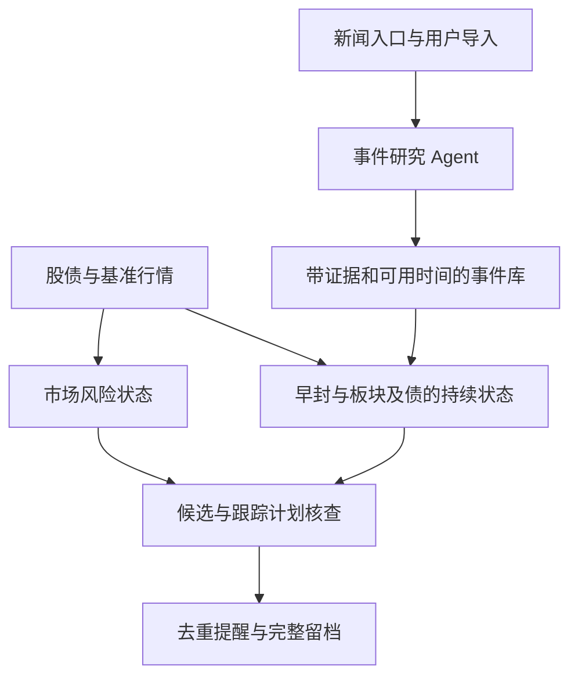

# 转债监控的事件 Agent 与市场风险优化

**项目应同时理解事件、观察市场环境，并持续跟踪股债机会。** 新闻研究 Agent 负责把新消息变成带证据和时间的观察对象；行情程序负责市场风险、股债状态、价格约束和提醒。保隆的午后路径说明：市场先转弱时，即使正股和板块仍强，也应开始处理获利保护，不能只等债跌破自身K线结构。

2026年10月18日重整并完成[首次闭市验证](../监控分析/首次手动验证_20261018.md)。模式仍归入课程的C03当前预期、C06股债联动，具体早封和参与条件见[量化定义](早封核心转债_量化定义与监控优化.md)。主监控源码及原提醒范围保留；独立静默行情采集器已部署。原公社最多3条展示按用户要求保留，新增主动新闻研究和证据只在本地。

## 本地 Codex 定时分析作为第一阶段

**第一阶段采用现有服务器监控加本地Codex研究。** 服务器只新增行情采集模块，不新增新闻库、Agent或飞书消息；原股票名检索公社的最多3条展示继续保留。本次用Mac手动验证，能力整理为[可迁移技能和Windows接入流程](../监控分析/Windows运行说明.md)，用户指定未来在Windows Codex运行；当前Mac不启用调度。下文服务器内Agent属于后续可选设计，当前不实施。

```text
服务器现有采集与已启用提醒
          ↓ SSH只读获取近期信息
本地分析快照＋必要的外部行情／新闻
          ↓ Codex定时研究
新事件与候选、市场风险、条件变化、证据和未知项
          ↓
本地留档，重要变化在当前对话提示
```

官方OpenAI文档确认，本地项目定时任务可以使用项目目录、技能和连接工具，需要电脑和应用保持运行；同一对话可按分钟间隔继续处理，并应先手动验证提示词。见[定时任务说明](https://learn.chatgpt.com/docs/automations?surface=app)。CLI也提供[非交互运行](https://learn.chatgpt.com/docs/non-interactive-mode)，供以后确有需要时接入脚本。盘前、盘中每10分钟和盘后研究先保存为任务要求，在Windows手动验证且用户要求启用后再创建；执行约定见[分析流程](../监控分析/分析流程.md)。

### 最小接入需要什么

Mac已有该项目的SSH访问配置；本轮手动SSH与本地读取脚本均已成功。第一阶段使用SSH执行受限只读查询，将结果整理为本地JSON，不复制密钥或让模型反复扫描整份服务器日志。定时环境仍需首个开市日核验权限、数据新鲜度及延迟。

现有`status`只输出事件计数、队列和健康记录，不能替代选股及分钟分析。`states/events/themes/bond_jobs`和原始行情归档可提供近期状态及证据；正股／债的最新缓存主要在进程内，数据库不是完整价格序列接口。应增加一个独立读取／整理步骤，或先从已有记录提取有限范围；这是数据桥接工作，不必改动行情状态机和通知主流程。

快照已包含分析生成时间、报价日、最近观察事件和状态、股债/队友及5个基准报价源时间、静态题材缓存、股债资料、覆盖及缺失。5,576只股票参考名单和311只债已成功取数；完整同步分钟、真实首封和完整债交易状态仍未补齐。用户持仓只有实际提供后才纳入，本地Codex不会从缺失记录推导出行情或成交。

SQLite用只读连接，不能直接复制运行中的数据库文件而遗漏WAL；原始归档正在追加时应保留完整记录及读取截止，遇未完成记录标出缺口。现由独立的[读取脚本](../监控分析/fetch_snapshot.py)调用采集器只读导出，不向原监控添加`export_snapshot`命令，也不写主数据库。

### 定时研究的工作范围

- 盘前：检查新催化和旧闻，生成带来源的事件及股债观察池。
- 盘中：按用户要求每10分钟研究，只分析新增事件、重点候选、市场变化及已有计划，不每轮重读所有课程。
- 盘后：保留成功、失败、漏报及放弃，比较判断与后来实际路径。

上述频率只是试运行建议，不是调度或完成时间承诺。定期研究的响应耗时包含等待下次运行、数据整理、检索分析和报告；它不承担秒级开板识别及唯一止损职责，服务器既有采集和已启用提醒继续独立工作。若未来需要快速的市场风控提醒，再把已验证的确定性规则放到服务器；新闻语义研究仍可以留在本地。

先使用现有Codex及默认可用模型验证，比较证据准确性、耗时、漏报和使用量，再决定是否需要更强推理或其他Agent。无需先为此接入独立模型API。这里本地指工具执行及资料位置，分析仍依赖联网和账号可用能力；读取服务器所需的网络及文件权限须在定时环境可用。

一个可先手动试跑的提示词应明确：

```text
读取本地整理的最新服务器快照，核对截止时间、行情源时间和缺口。
只分析上次运行后新增的信息，并持续检查已有跟踪计划。
结合课程C03/C06研究新事件、早封地位、无债队友、债响应和市场环境。
查新闻原文，区分已确认事实、社区映射、旧闻、更正和未知。
输出新候选、已有候选变化、市场风险、目标／失效条件变化及数据缺口。
引用来源；没有真实入场记录就不假设持仓，不把参考价当成交。
信息陈旧时说明截至时间，暂停新增判断；没有重要变化时保持安静。
定时运行不修改服务器配置、发送开关或订单，不向服务器回写新增新闻。
```

运行记录和行情快照继续在本地`课程视频/`内，分析进度用最后处理的事件ID与时间保存，避免重复研究和重复提示。输出先回当前Codex对话；外部群推送另行配置，不自动复用已有群的发送权限。

## 午后市场风险应该更早出现

使用已经保存的1分钟行情，同步比较上证、中证转债指数、转债ETF和保隆股债。下表指数变化**相对各自11:30收盘**，不是相对昨收；每个时点只使用当时完成的分钟。

| 时点 | 上证较午收 | 中证转债较午收 | 保隆债 | 当时的含义 |
|---|---:|---:|---:|---|
| 13:05 | −0.25% | −0.08% | 145.159 | 股市和债市开始共同走弱，债仍封涨停。 |
| 13:10 | −0.39% | −0.18% | 145.159 | 环境恶化已经可见，可以提醒检查已有利润和退出计划。 |
| 13:20 | −0.54% | −0.46% | 145.159 | 弱势延续；仅看正股、同题材封板或债价不动，容易忽略共同风险。 |
| 13:29 | −0.72% | −0.50% | 145.159 | 环境继续承压，债本身仍未给出开板价格信号。 |
| 13:30 | −0.70% | −0.47% | 142.931 | 本轮债涨停首次在分钟中打开，债自身保护条件开始触发。 |
| 13:35 | −0.73% | −0.56% | 140.948 | 是旧规则下一根延迟退出参考，不能当作更早已能成交的价。 |

保隆正股上述时段均为29.39，五只参考队友也仍强。保隆债13:02—13:29的分钟OHLC保持145.159，13:30分钟最低142.392、收142.931。因此，应保留“市场走弱与个券高位重估压力”的联合解释。时间先后支持把市场风险提前加入监控，尚不能识别大盘对本次开板的因果贡献，更不能证明提前某分钟必然卖得更好。


转债ETF用来交叉检查转债市场，不能与中证转债指数算作两个独立风险因子。强板时退出还需当时买方深度；封在单一价格不证明任意规模均可卖出。本轮没有给13:10或13:20添加事后优化出的卖点，也未修改原价格回放收益。

## Agent 的职责和信息入口

建议接入一个**有固定工具和调用预算的事件研究 Agent**。采集器可以监控已接入的网页、公告、信息流和用户转入链接；模型补上新旧消息辨别、语义理解、证据追溯和产业到标的的映射。Agent 本身不会自动获得全网实时新闻，新闻入口的可访问性、覆盖和延迟仍须分别验证。

现有代码是正股触板后，按股票名异步搜索公社，并且同股同日只搜索一次。这个设计适合补充涨停解释，缺少“消息先到、股债还没有明显反应”的发现入口，也可能错过同日后续更正。应增加主动事件发现，同时保留价格异动后的反查。

| 入口 | 第一阶段怎样做 | 应保留的边界 |
|---|---|---|
| 用户发现的新闻 | 导入公社、X、公司公告或发布会链接，也支持粘贴原文 | 保存用户提交时间，发布时间和自己看到时间分开；正文抓不到时只分析可读内容。 |
| 公社线索 | 在已核对可访问的公开入口检索观察主题、公司与事件词，去重并追踪更新 | 现有标题／短片段能力不能冒充全文；页面显示的旧发布时间不能证明后来正文当时已存在。 |
| 官方事实 | 查询公司／交易所公告、发行人资料及可访问的官方发布内容 | 新闻本身属实，不代表某A股公司获得订单，逐条关系分别核实。 |
| X及其他新闻流 | 预留经授权的适配器，未接入前可用用户导入链接 | 不宣称已覆盖全量实时X，不以模型记忆代替刚发布的原文。 |
| 价格异动反查 | 涨停、板块扩散或转债异常触发事件研究任务 | 是发现线索的另一入口，不能反过来把后查到的消息填成此前已知。 |

公社[10/14页面](https://www.jiuyangongshe.com/a/3y8by16emc0)确实显示当日讨论的标题及时间。以本次核对可读范围为准，未取得的正文不能由Agent自行补全。“飞行汽车新闻→低空方向→保隆业务映射”可以列候选链；“保隆是新车飞行系统唯一供应商”必须有对应独立证据。

### 一次事件研究的输出

固定流程为：原文与时间提取→识别新增事实及旧闻→追溯原始出处→查询公司业务与股债表→输出有依据及待证关系→版本化入库。相同原始消息的多个转载合并来源链，不能当作多家独立确认。

| 字段 | 作用 |
|---|---|
| `event_id`、事件类别和有效窗口 | 区分发布预期、已发布事实、旧业务介绍和事后复盘，催化兑现后重新评价。 |
| `claims[]`、支持或反对的原文引用 | 每条主张分别标官方确认、社区讨论、分析映射、未知或已否认。 |
| `entities[]`、`relations[]` | 标准证券代码、公司、产品、技术、板块及队友；关系必须关联具体证据，允许保留未知。 |
| `published_at`、`first_received_at`、`analyzed_at`、`available_at` | 可用于信号的时间不得早于系统收到并完成必要校验的时点，不按原文旧日期回填。 |
| `source_url`、快照哈希、证据版本 | 支持事后追溯、内容修改和更正，不只保留一句模型总结。 |
| `mapping_status`、矛盾证据和待核项 | “事件官方确认”“公司关联已确认”“股票当前核心候选”分别表示，不能一项确认带动全部确认。 |

代码检查证券身份、引用是否存在、结构、时间和数据版本；这些检查不能保证所有语义判断正确。自动提出的关联可以先进入标注为待核的观察池，核心供货或排他性断言没有证据就保持未知。模型自报的置信度不作为交易胜率。

第一版采用一个异步worker和小型工具集，先做提取、核对及映射；确有证据缺口时再允许有限次检索，设置超时、调用和费用预算。工程取舍参考[Anthropic的工作流与Agent设计说明](https://www.anthropic.com/engineering/building-effective-agents)，这里选择受控流程是本项目的设计判断，不绑定模型厂商或框架。

第一阶段由本地Codex定时任务承载上述事件研究能力，新闻证据、版本及关系只写本地。服务器内的异步Agent如有需求需另行决定，当前不建设。工具范围限定为读取消息、公司资料和股债表、写入本地研究证据版本；行情规则、发送开关和订单执行不交给新闻模型修改，网页内容只作为待核资料。

## 增加独立的市场风险层

整体风险至少观察两类：A股环境和转债承接。第一阶段接入上证与中证转债指数，ETF作可用性和方向交叉检查；后续根据事件风格补小盘／成长基准。全市场红盘率、炸板率和跌停扩散在覆盖可核验后再加入，不能把有债正股或六只题材股的样本冒充全市场。

| 特征 | 计算与用途 |
|---|---|
| 短时变动 | 已完成的5、15分钟收益，跨午休的午收比较单列，不能伪装成连续5分钟收益。 |
| 从当时高点回撤 | 使用截至当时的运行最高价，避免拿后来全天最高点回填。 |
| 段内方向 | 午后相对已知11:30收盘及复市后完成线观察，开盘与午后分别保留基准。 |
| 股债共振 | A股与转债市场是否共同转弱；一个宽基下跌只是一项信息，局部独立行情仍单列。 |
| 板块相对强弱 | 排除自身的队友强度、封板保持及相对市场表现；板块强不抵消已经出现的共同风险。 |
| 数据可信度 | 每个基准的源时间、收到时间、交易时段、覆盖和缺口；未知不填成正常。 |

将风险状态与机会状态分开保存。初期阈值只作预先固定的研究假设：例如共同转弱连续若干根、回撤超过过去已完成样本的波动尺度，再在新日期评估误报与损失，不能为刚好赶在13:30之前退出调参数。

| 风险状态 | 新候选 | 已有跟踪计划 |
|---|---|---|
| 正常 | 继续按事件、早封、助攻、债确认及价格上限评估 | 执行原目标、保护和到时规则。 |
| 警惕 | 降低优先级，暂停新预判分支，确认分支需重新核对条件 | 提醒检查兑现和流动性；债仍强也要显示环境变化。 |
| 防守 | 暂停新增参与候选，继续记录被过滤的机会 | 触发用户事先设置的市场风险退出／保护核查，已设保护位不放宽。 |
| 未知 | 暂停新增，不把缺数当成低风险 | 报数据异常；保留已知风险与原固定失效条件，不制造新的成交判断。 |

风险恢复也需有效数据和持续确认，不能一个反弹快照就清除。市场提示是更早的获利保护依据，个券失效是另一条退出依据；Agent关于题材的积极解释不能覆盖市场防守状态、固定止损或到时安排。

本例需要的提醒次序是：**市场走弱、债仍封板的风险提示→债开板／保护位破坏提示→未结束计划继续跟踪。** 是否在第一阶段兑现、兑现多少，由预先记录的计划决定；监控项目不自动执行订单，也不把“发出风险提示”登记成已经卖出。

## 重整后的项目结构



服务器继续保留单进程、asyncio、SQLite与systemd；第一阶段本地Codex读取快照，行情循环不等待检索或模型。若未来将Agent嵌入项目，再以独立异步任务消费新闻队列。股债静态资料仍由盘前任务维护；动态事件允许盘中新版本入库，行情循环只读已校验、到当时可用的事件快照。两类资料分开，避免把“盘前准备静态资料”误解为全天不能接受新事件。

市场风险与机会状态直接由代码计算。没有新新闻时不重复调用模型；同一事件内容未变时复用结果；有新事实、反证或内容修改才重新核对。新闻或模型故障时，原有行情、基准风险及固定退出核查继续运行，事件关系标缺失／旧版本。

### 对应当前代码的改造顺序

已核对私有仓库[cb-limitup-monitor](https://github.com/surfacebuaa-maker/cb-limitup-monitor)，版本0.7.1、提交`1c6f36e`，主源码未改。下表是后续确需项目内集成时的可选清单；行情基准与全市场采集已由独立模块部分实现，新闻相关能力当前仅在本地，不向服务器实施：

| 优先级 | 模块 | 具体工作及验收 |
|---|---|---|
| P0 | 行情与`market_context.py` | 接少量股债基准，保存同步风险特征，缺口为未知；风险更新不依赖个股新触板。验证13:05—13:30的观察顺序，而非优化收益。 |
| P0 | 事件库与`news_ingest.py` | 新闻／用户链接先入库，保存原文和四类时间；主动主题发现与价格反查并行，按来源限制请求。 |
| P0 | `event_research.py` | 提取、查证、股票与有效债映射；一个有预算的异步Agent，输出严格结构和证据，失败可降级。 |
| P0 | 持续机会状态 | 补无债队友、早封履历、债确认、价格上限及活跃债集合；正股不变化也能触发，破板后仍跟踪债风险。 |
| P0 | 统一决策与通知 | 合并事件可用性、市场状态和机会状态。市场风险是独立消息，能先于债开板出现，不等待新闻摘要或原正股首报。 |
| P1 | `themes.py`及`storage.py` | 保留现有股票名补充查询，新增事件ID／内容版本去重；打破同股同日只研究一次的限制，新增事实或辟谣可更新。 |
| P1 | 数据与运行保障 | 完整候选分钟、盘口、有效债状态、持久化恢复、模型延迟与预算、源失败及提醒过期；复用缓存，先测覆盖再考虑提频。 |

`storage.py`当前投递查询只允许`market/health`独立发送，其余种类依赖父消息成功。新增市场风险及主动事件提醒必须设计独立可投递的根事件，不能仅加一个类型名却永远等待不存在的父消息。风险消息优先级高于新闻解释，保留原有发送开关与模拟隔离。

新增表以最少三组为起点：`news_items/event_versions/event_relations`存证据及时间，`market_context`存环境快照，`opportunity_states/tracked_plans`存持续机会及用户计划；原有outbox复用。具体是否合并表在实施时按SQLite现状决定，不引入额外数据库或队列服务。

## 验证标准

- **事件质量：** 人工标注样本检查旧闻、新消息、错误供货关系、转载重复、正文缺失及辟谣；衡量有证据的映射准确性、未知率和漏报，不只看摘要是否流畅。
- **时点正确：** 历史回放使用当时系统已经收到并校验的版本；消息虽早发布、系统晚发现，不得提前产生候选。更正保留旧版本，未来消息不能改变过去结果。
- **市场风险：** 保留大盘弱而局部债继续强的误报、市场与债同时下跌、市场稳而个券独立失败；防守过滤掉的上涨也保留。比较加入环境前后的预警提前量、误报和后续路径。
- **持续运行：** Agent超时、检索失败或预算耗尽不阻塞行情；风险消息不被摘要阻塞；重复新闻、重复快照及重启不重复提醒。市场未知时不放行新候选，原活跃债仍跟踪。
- **成本与延迟：** 分别报告新闻发布时间、系统发现、分析可用、行情触发、消息入队和实际到达；测新闻到候选的耗时与每事件模型／网络成本。仅有接口返回不能声称覆盖和延迟达标。

优先落地按“手动只读获取并分析一次→整理稳定快照→本地Codex定时增量研究→连续日期评价”推进。Mac闭市取数和本地读取已通过，Windows环境、实盘时效及模式有效性待后续验证。用户指定未来在Windows运行，当前Mac上的4个任务已删除；没有新增付费服务或独立采集器线上推送。新闻仍在本地，原公社展示保留。

## 本地材料

[午后120个同步时点及5个对象特征](../课程视频/低空股债联动_20261016/市场与事件Agent优化/午后市场同步特征.json)、[重点时点表](../课程视频/低空股债联动_20261016/市场与事件Agent优化/午后重点时点.csv)和[计算脚本](../课程视频/低空股债联动_20261016/市场与事件Agent优化/核对午后环境.py)均在Git忽略的本地目录，保存输入SHA256；每一时点的全量与截断输入结果一致。相关后续成果和完成标准见[总TODO](../TODO.md)。
